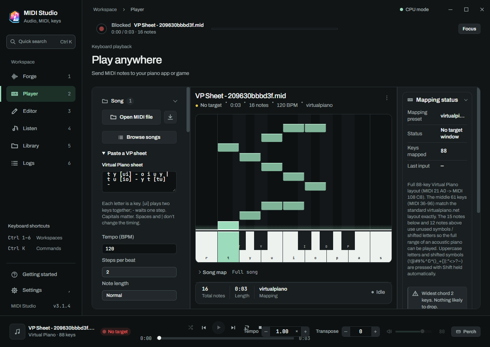
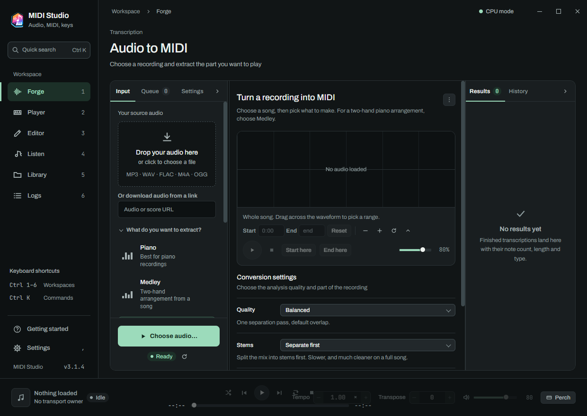
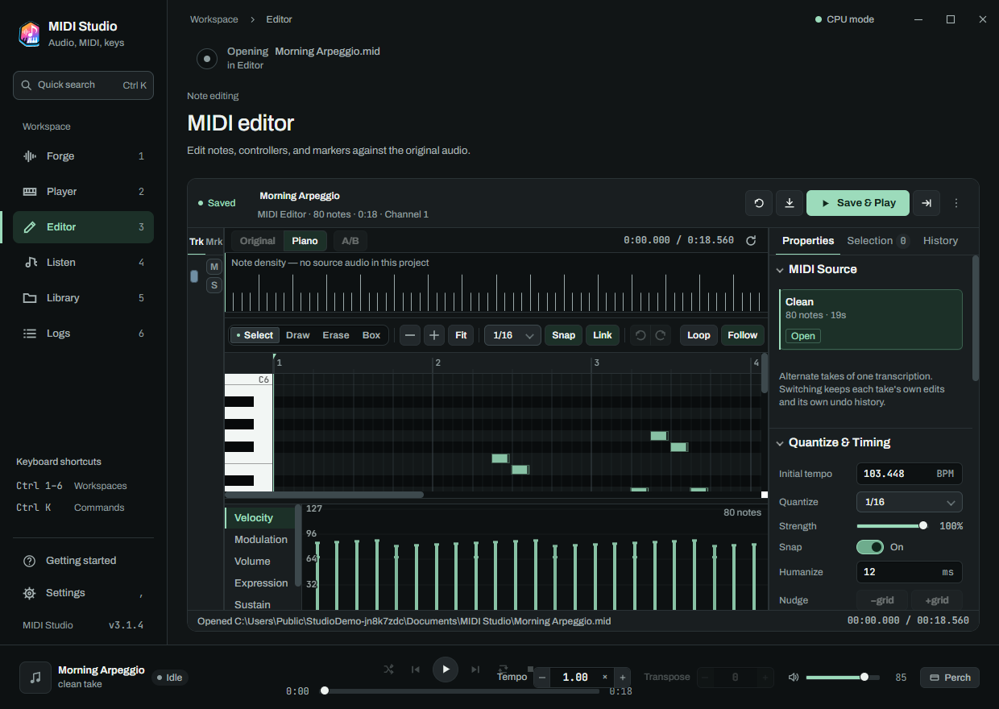
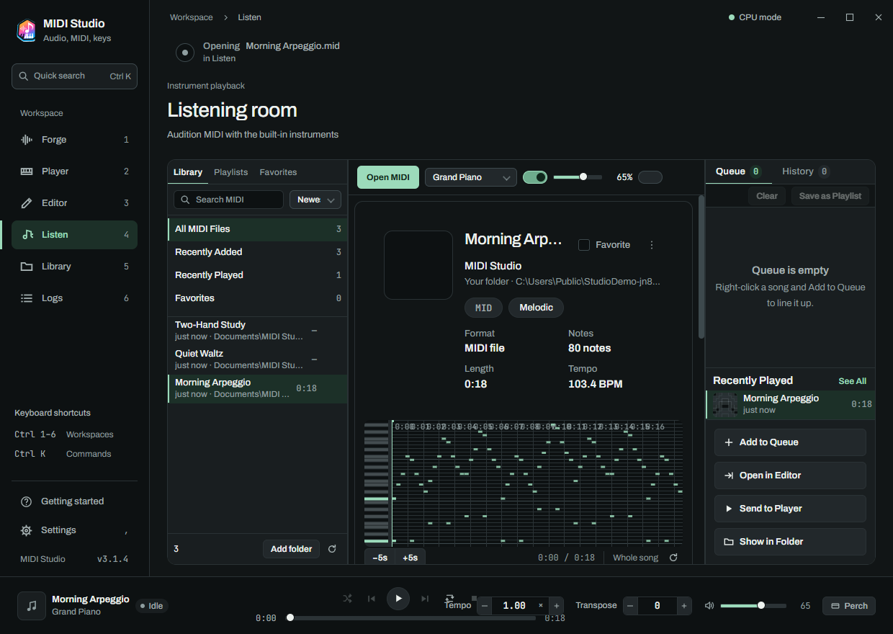
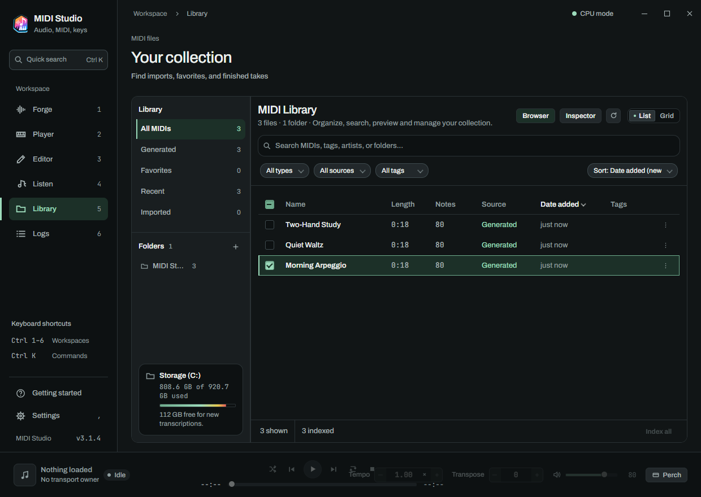
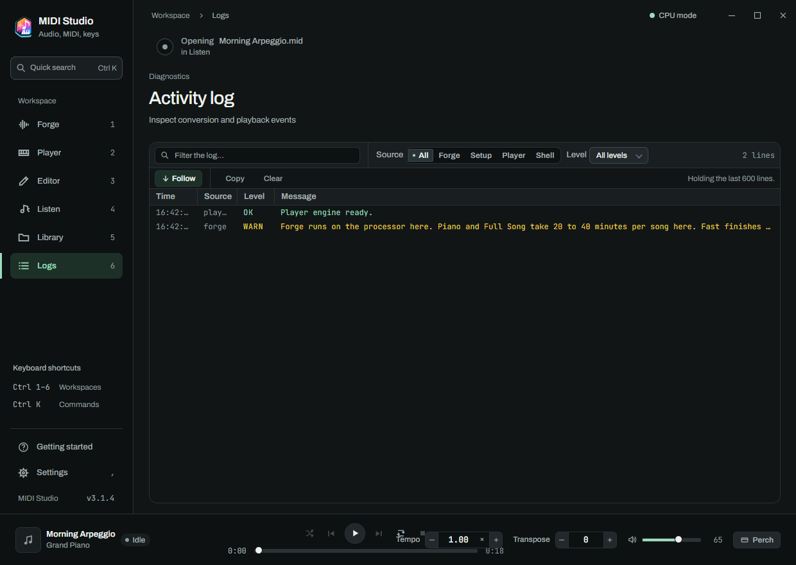

<p align="center"></p>
<h1 align="center">MIDI Studio</h1>
<p align="center">Turn a recording into piano notes, edit what you hear, or play a Virtual Piano sheet into a game.</p>
<p align="center"><strong><a href="https://github.com/StarsationX/midi-studio/releases/latest">Download for Windows x64</a></strong> · <a href="#your-first-song">Your first song</a> · <a href="#play-a-virtual-piano-sheet">Try a VP sheet</a> · <a href="CHANGELOG.md">What’s new</a></p>
<p align="center">
  <a href="https://github.com/StarsationX/midi-studio/releases"></a>
  <a href="https://github.com/StarsationX/midi-studio/releases/latest"></a>
</p>



## Your first song

On the [release page](https://github.com/StarsationX/midi-studio/releases/latest), open **Assets** and run `MIDI-Studio-<version>-Setup.exe`. This is the Rust/Tauri edition. Windows may show an unknown-publisher warning because the installer is unsigned.

**Forge setup is optional.** Skip it if you only want to listen, edit MIDI, or play sheets. To convert recordings, opt in during installation or open setup in Forge later. Review the missing download size before continuing. NVIDIA acceleration is a separate choice; it is not required for CPU transcription.

**Already installed?** Install over your current copy and keep your Forge storage folder. Don’t uninstall first. Setup preserves compatible components and the original local Medley model before replacing the old app. Studio checks GitHub for updates and verifies the installer’s SHA-256 before launching it.

| What you have | Where to start |
| --- | --- |
| **A MIDI file to hear** | **Listen → Open MIDI and play.** No game, Python, or model setup needed. |
| **An MP3 or WAV** | **Forge → Choose audio… → Fast → Create MIDI.** Open the finished file from **Results**. If prompted to **Set up audio conversion**, pick a storage folder with the free space shown; some engines need several GB. |
| **Notes to correct** | Open the MIDI in **Editor**. You’ll hear a sampled acoustic grand on every channel without changing the instruments saved in the file. Use **Original** to compare with an attached recording. |
| **A MIDI file to play in a game** | Open the game, then **Player → Open MIDI file**. Under **Target**, select the game window; choose its keyboard mapping and press **Play**. Playback pauses if the target loses focus. |
| **A pasted sheet instead of a file** | Open **Player → Song → Paste a VP sheet**. Try the example below before selecting a game window. |

The left sidebar switches workspaces. **Getting started** reopens the first-launch guide; **Ctrl+K** searches commands and songs. In **Player**, **Listen**, and **Editor**, you can change speed mid-song without jumping back to the start.

## Workspace gallery

Select a screenshot to see it at full size.

| **Forge** · Turn a recording into MIDI | **Editor** · Correct notes in the piano roll |
| --- | --- |
| [](docs/img/workspace-forge.png) | [](docs/img/workspace-editor.png) |
| **Listen** · Audition a MIDI file | **Library** · Find a song and open it in another workspace |
| [](docs/img/workspace-listen.png) | [](docs/img/workspace-library.png) |

<details>
<summary><strong>Logs</strong> · Inspect messages when something goes wrong</summary>

[](docs/img/workspace-logs.png)

</details>

The download badges use GitHub’s release asset counts. The all-releases count includes optional Forge component downloads; the latest stable app release contains only the installer. Repeat downloads and updates can count. These are not unique users or completed installs; no in-app tracking is needed.

## Play a Virtual Piano sheet

Paste this into **Player → Song → Paste a VP sheet** and choose **Load only**. You’ll see the notes before any keys are sent:

```text
t y [ui] - o
```

Read it as: play `t`, then `y`, press `u` and `i` together, wait one step, then play `o`. Capitals matter. Spaces, newlines, and `|` make the sheet easier to read; they don’t add time.

Start at **120 BPM** and **2 steps per beat**: each step lasts a quarter second. Lower the BPM to slow down, or change **Note length** for shorter or longer holds with **Sustain** on. When ready, select your game under **Target** and press **Play**. Next time, with the target already selected, **Auto Play** loads and starts the pasted sheet in one click.

## Arrange a recording with Medley

**Medley** (formerly **Expressive Piano**) arranges a recording for two hands: the right hand follows vocal and instrumental melodies, while the left plays bass and chords. Choose **Melody** instead if you want only the lead line.

On a picked guitar passage, listen for the low notes between strums. Medley can keep a softly picked low note when both its pitch and an overtone rise above the surrounding sound. It requires an isolated guitar for this extra recovery, so a quiet harmonic in a full band needn’t become a new left-hand key. This is a two-hand arrangement, not a note-for-note transcription.

If the bass steps back while the melody stays loud, listen for the same change in the piano. Medley measures the original mix and its sampled Grand Piano in the same frequency ranges, over both a short accent and half a second of music. The separated instruments tell it where there’s pitched sound to follow, so a drum-only break doesn’t turn into a piano swell.

Try a passage where one hand changes chords while the other repeats a note. Medley compares the sound of its sampled keys, including what keeps ringing after key-up, with the same passage in the original. A loud tail from the last chord needn’t become a loud new strike. This adjusts how hard the keys are played; it doesn’t add notes or move the beat.

To hear the bass balance, try a verse where the left-hand line grows stronger under a steady melody. Medley checks how much each ringing piano key contributes to the low and middle ranges: it can bring out a separate bass note without turning up the whole chord.

Re-run **Forge → Medley** to hear the new touch. Your earlier MIDI stays available for comparison; no new model is needed.

Listen to the space between picked notes. One string can keep ringing while the next one starts; Medley can hold that piano key instead of cutting both notes to the same length. For a short low pluck, it follows the pitch and an overtone into the decay rather than stretching every note with the sustain pedal. Vocal phrases still release when the vowel fades.

For exposed piano passages, Medley keeps the detected key velocities and writes the sustain pedal. A quiet gap need not lift the pedal; when the pedal is up, Medley can use the free hand for a new note so a held key keeps ringing. **Listen** follows the pedal when **Sustain** is on. In **Editor**, open the **Sustain** controller lane to adjust it without lengthening the key presses.

Medley uses the original six-stem separator. The public installer **does not bundle, download, or substitute** that model.
The [model source and license information](https://huggingface.co/FractalSurfer/BS-RoFormer-SW-6stem#license) is provided for reference; the mirror grants no additional rights. Only import a copy you’re authorized to use. Otherwise choose **Fast** in Forge to convert audio without it.

<details>
<summary><strong>Import or preserve an existing Medley model</strong></summary>

- **On an existing installation:** Setup checks for the original model before replacing the app. If it can’t safely preserve it, setup stops. If you used a portable copy, keep it until the new app shows Medley is ready.
- **If Setup stops with code 26:** Leave the old app installed. Retry with the new installer under the Windows account that used MIDI Studio; if it still stops, send support the entire message, including the preservation check that failed.
- **On a new PC with your own model:** Open **Forge → Medley → Import existing Medley model → Choose local model…** and select `bsrofo_sw_body.onnx`. Studio verifies the file before using it.
- **If you only have `BS-Rofo-SW-Fixed.ckpt`:** Keep its matching YAML file. Offline conversion also needs your original local Forge Python and MSST installation. The checkpoint alone isn’t enough.

</details>

Once Medley is ready, choose a recording and select **Create MIDI**. From **Results**, open the arrangement in **Editor** to adjust it or **Listen** to hear it.

## Beyond your first song

- **Import a MuseScore score without transcribing audio.** Paste the score link into Forge and choose **Get MIDI**. If the public player delivers a MIDI, Studio opens that file unchanged in Editor. Other supported links, such as YouTube and SoundCloud, import **audio** for transcription instead.
- **If a YouTube audio download stalls:** Forge automatically tries an alternate media server when YouTube lists one and the first one times out. If the download still fails, retry later or on another network.
- **Edit expression as well as pitch.** Editor supports modulation, volume, pan, expression, sustain, and named MIDI markers. Controller edits are saved to the MIDI file; the in-app note preview doesn’t perform them.
- **Find a song or diagnose a job.** Use **Library** to search, tag, or favorite a file. If a conversion fails, open **Logs** to copy its diagnostics.

## Build the Rust edition

<details>
<summary><strong>Windows prerequisites, development and packaging</strong></summary>

The shipped Windows app uses [Tauri](src-tauri/) with a WebView2 interface, an [in-process Rust keyboard player](player-rs/), and the [Rust Forge engine](forge-rs/). Some optional conversion tools still use [Python](python-engine/). The [Electron host](electron/) is legacy: `npm start` and `npm run build:nsis` are **not** the Rust build.

For Windows development, install Git, Node.js with npm, Rust stable (MSVC), the Visual Studio C++ Build Tools with a Windows SDK, and WebView2. To work on the desktop and player without packaging Forge models:

```powershell
git clone https://github.com/StarsationX/midi-studio.git
cd midi-studio
npm ci
cargo run --locked --manifest-path src-tauri/Cargo.toml --bin midi-studio
```

To package the **slim Windows installer**, staging needs Python 3.11+ for notices and archives. It does not require any model weights. The [optional Forge component manifest](tools/forge-components.json) pins the downloadable files by size and SHA-256. To reproduce those components separately, run `python tools/stage_native_assets.py --components` with the verified Transkun 2.0.1 exports under `MIDI_STUDIO_MODELS_DIR/onnx`. The private Medley separator is **not** a build input.

```powershell
npm run build:tauri
```

The application is `src-tauri\target\release\MIDI Studio.exe`. The Windows installer is under `src-tauri\target\release\bundle\nsis\`.

</details>

## License and credits

MIDI Studio’s code is [MIT-licensed](LICENSE). Instruments, fonts, runtimes and optional transcription models have [separate licenses and credits](third-party/THIRD-PARTY.txt); in particular, the GAME model weights are licensed for noncommercial use under CC BY-NC-SA 4.0.

The MuseScore public-player import was informed by [ingui-n/musescore-downloader](https://github.com/ingui-n/musescore-downloader); its extension is not bundled. See [DESIGN.md](DESIGN.md) for interface credits.
