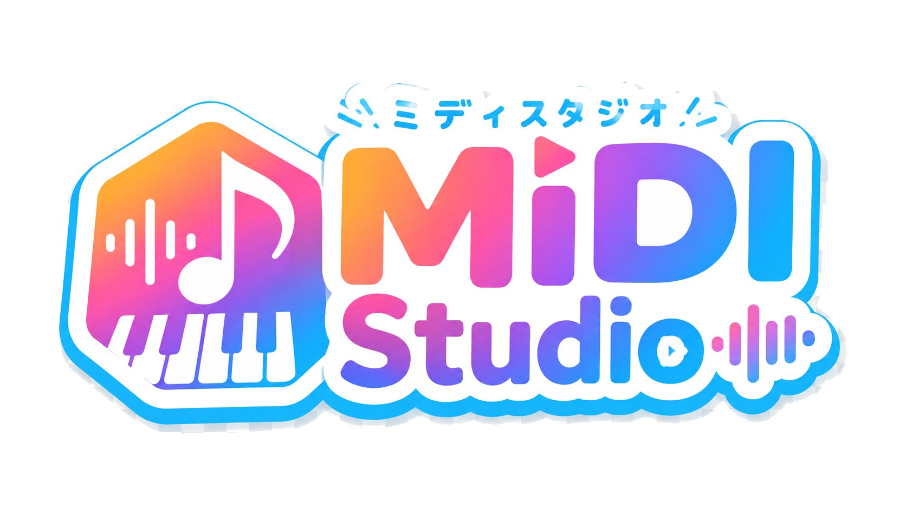
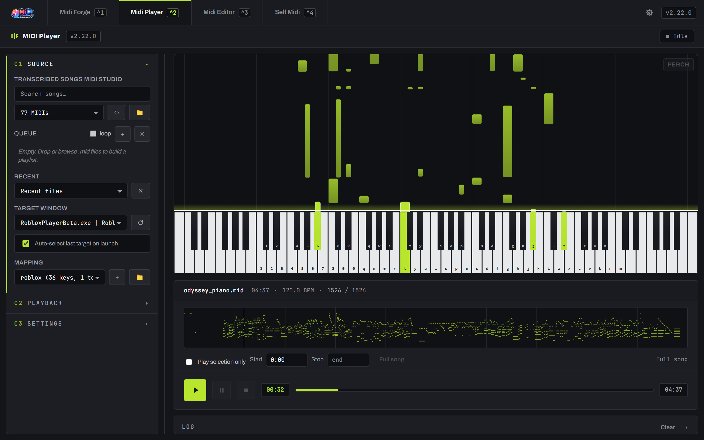
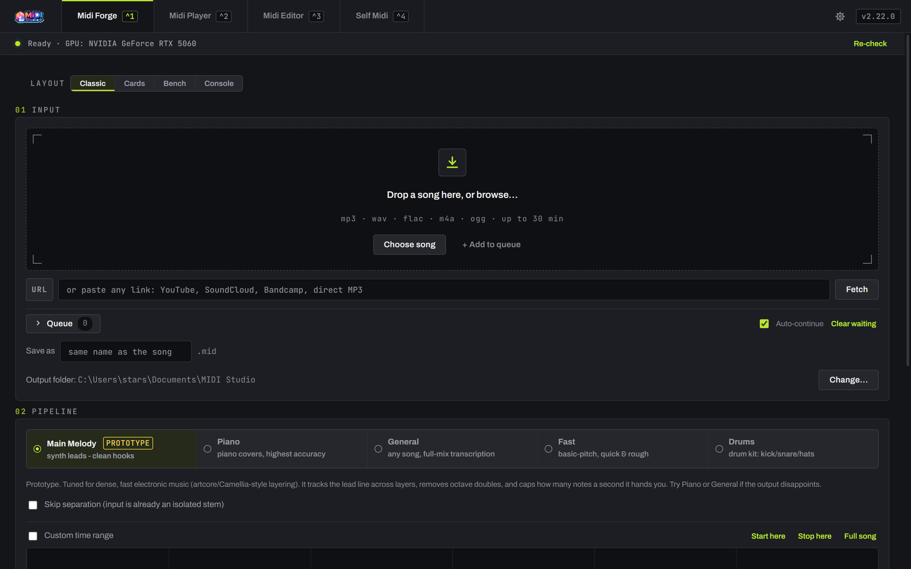
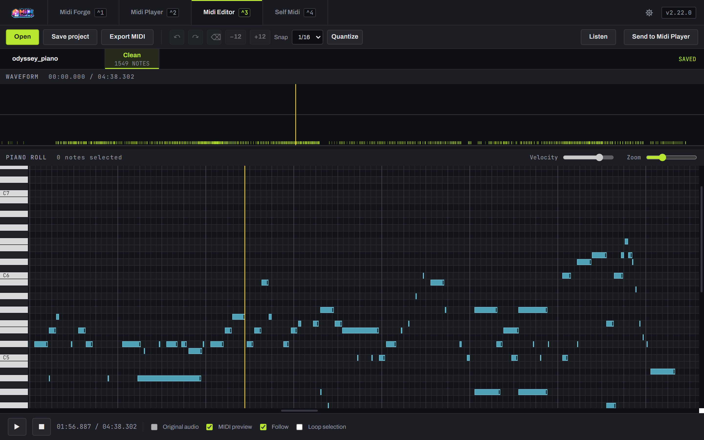
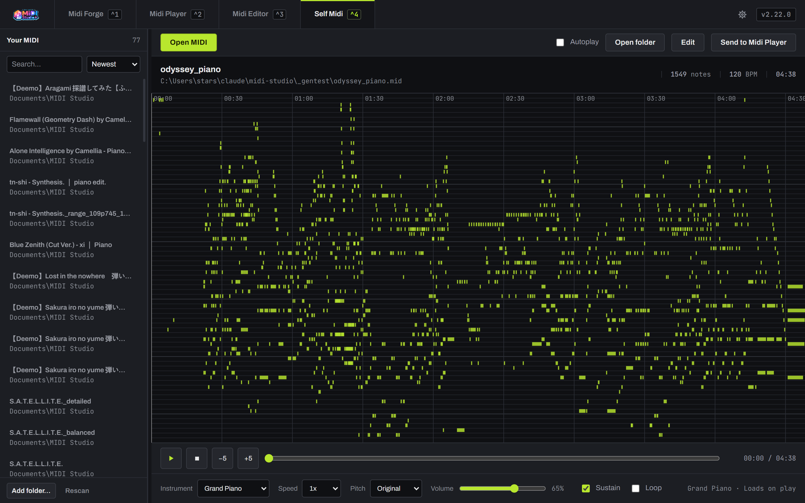

<div align="center">



**Turn a song into MIDI, edit it, and play it back on any keyboard.**

[](https://github.com/StarsationX/midi-studio/releases/latest)
[](https://github.com/StarsationX/midi-studio/releases)
[](./LICENSE)
[](https://github.com/StarsationX/midi-studio/releases/latest)



</div>

---

## What it does

Six workspaces, one window. Drop a song in the first, and it comes out the other end as something
you can actually play.

|  | | |
|---|---|---|
| **Midi Forge** | Song → MIDI | Feed it an audio file or a YouTube/SoundCloud link. AI source separation splits the mix, then transcription turns the part you care about into notes: piano, full mix, a synth lead, or a full drum kit — kick, snare, closed and open hat, three toms, crash and ride. |
| **Midi Player** | MIDI → keystrokes | Plays a MIDI into any other Windows app by simulating keypresses, for Roblox piano games, [virtualpiano.net](https://virtualpiano.net), or anything else that listens to a keyboard. Live piano roll, global hotkeys, tempo and transpose, and it pauses itself when the target window loses focus. |
| **Midi Editor** | Fix the transcription | Piano-roll editing against the original waveform. Edit notes, MIDI controllers, and named markers with undo/redo, then save or export. |
| **Self Midi** | Just listen | Plays a MIDI inside the app with bundled General MIDI instruments, no game or target window needed. |
| **Library** | Organize MIDI | Search, filter, tag, and favorite your files, then open them in any workspace. |
| **Logs** | Inspect activity | Review conversion and playback events, filter errors, and copy diagnostics. |

In **Midi Forge → Medley** (formerly Expressive Piano), the Rust engine follows
the vocal and instrumental melody with the right hand and voices bass and chords
for the left. **Melody** is a separate lead-only mode.

<table>
<tr>
<td width="50%"><br><sub><b>Midi Forge</b> — pick a pipeline, drop a song</sub></td>
<td width="50%"><br><sub><b>Midi Editor</b> — notes against the original audio</sub></td>
</tr>
<tr>
<td width="50%"><br><sub><b>Self Midi</b> — your library, played in-app</sub></td>
<td width="50%"><br><sub><b>Midi Player</b> — live roll, mapped to a real keyboard</sub></td>
</tr>
</table>

## Download

**[⬇ Get the latest installer](https://github.com/StarsationX/midi-studio/releases/latest)** —
grab `MIDI-Studio-<version>-Setup.exe` and run it. Windows x64.

**No separate Python install is required.** The Player, Editor, and Self Midi tabs work the moment
setup finishes.

On first launch, **Getting started** lets you choose what you want to do. Open it again
from the sidebar at any time.

- **Listen to a MIDI file:** select **Open MIDI and play**. No Forge download needed.
- **Turn audio into MIDI:** select **Choose audio…**, pick your recording, then choose
  **Medley** for a two-hand piano arrangement. Select **Create MIDI**. The finished
  file appears in **Results**, where you can listen to it or open its folder.
- If the selected engine needs installation, the same button opens **Set up audio
  conversion**. Check the free space shown, keep the suggested folder or change it,
  then choose **Install**. This can download several GB. If the engine is ready,
  skip setup. Your audio stays selected either way.

> [!NOTE]
> Windows SmartScreen will say "unknown publisher" — the build isn't code-signed yet.
> Choose **More info → Run anyway**.

## Updates

The app checks [Releases](https://github.com/StarsationX/midi-studio/releases) a few seconds after
launch, or on demand from the version badge. It verifies the download's SHA-256 against the digest
GitHub publishes for the release asset, then applies it through the full installer. Toggle it off in
**⚙ Settings** if you'd rather update by hand.

## Build from source

```powershell
git clone https://github.com/StarsationX/midi-studio.git
cd midi-studio
npm install

npm start            # dev run (needs Python 3.10+ with the player deps on PATH)
npm test             # unit tests
npm run build:nsis   # -> dist/MIDI-Studio-<version>-Setup.exe
npm run build:tauri  # Rust Forge + Tauri installer in src-tauri/target/release/bundle/nsis/
```

`build:nsis` builds the Electron edition with a bundled Python player.
`build:tauri` builds the native Windows edition and requires Rust and the Visual Studio C++
build tools. Its Player runs in-process in Rust. Both hosts use the same renderer.

The Editor saves modulation (CC1), volume (CC7), pan (CC10), expression (CC11), sustain
(CC64), and named MIDI markers. Other imported control changes also survive export.
The Editor's local audition remains a note preview; controller changes are written to the MIDI file.

Paste a MuseScore score link into Forge and choose **Get MIDI** (or press Enter).
An isolated browser loads the public player and saves the MIDI response unchanged,
then opens the file in Editor. This path does not need Forge's Python/model setup.
Other supported URLs import **audio** through yt-dlp for transcription.
If the public player does not deliver MIDI, the job reports an error without creating a file.

The public piano-player route was informed by
[ingui-n/musescore-downloader](https://github.com/ingui-n/musescore-downloader) (MIT).
MIDI Studio uses its desktop browser's response capture and does not bundle the extension.

Downloader regression tests: `python tools/test_yt_download.py` (no network or yt-dlp install required).

## How it's put together

```
electron/        main process, Python sidecar manager, forge runner/provisioner, updater
src-tauri/       native Windows host, IPC, document I/O, updater, and Forge management
player-rs/       native MIDI playback and keyboard engine
forge-rs/        native transcription and separation pipelines
renderer/        shell + the Forge, Player, Editor, and Self Midi tabs
python-engine/   midi_player.py + ipc_main.py       (playback engine)
                 song_to_midi / transcribe / ...    (forge pipeline)
                 provision_forge.py                 (the dependency downloader)
.github/         CI: build on Windows, publish on a v* tag
```

The shared HTML/CSS/JavaScript interface runs in Tauri or Electron. Tauri hosts the Rust
Player in-process; Electron supports the Rust or Python sidecar. Forge supports native
Rust pipelines and Python processing.

UI direction and design-guide credits are recorded in [DESIGN.md](./DESIGN.md).

## License

MIT — see [LICENSE](./LICENSE).
